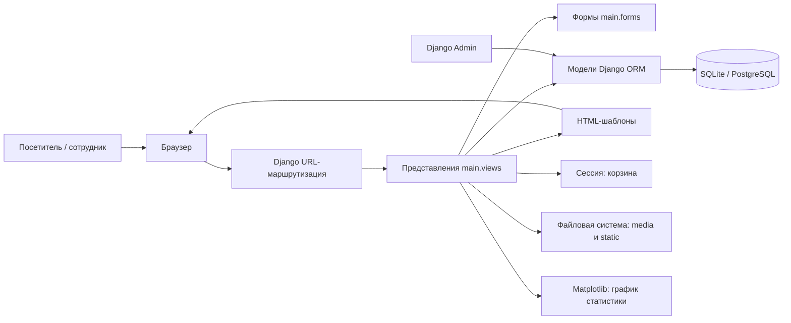

# PizzaTime — сайт пиццерии

Веб-приложение для знакомства с пиццерией, просмотра меню и оформления заказа на самовывоз или доставку. Целевая аудитория — посетители и клиенты пиццерии; сотрудники управляют содержимым через Django Admin.

## Технологии

- Python 3.12, Django (версия задаётся в `requirements.txt`), серверные HTML-шаблоны и CSS.
- SQLite для локального запуска; PostgreSQL при заданном `DATABASE_URL`.
- Django ORM, встроенные пользователи, сессии и административная панель.
- Matplotlib для графика в административной статистике; WhiteNoise для раздачи статики.

## Архитектура



## Модули

- `myproject/` — настройки, корневые URL, WSGI/ASGI.
- `main/models.py` — каталог, категории, промокоды, новости, отзывы, контакты и сведения о компании.
- `main/views.py` — страницы, корзина в сессии, оформление, отзывы и статистика.
- `main/forms.py` — формы регистрации, отзыва и оформления заказа с проверкой полей.
- `main/templates/` и `main/static/` — пользовательский интерфейс.
- `main/migrations/` — схема и начальные данные.
- `media/` — загружаемые изображения.
- `lab1/`, `lab2/` — материалы лабораторных работ.

## Интеграции и данные

Реляционная БД хранит каталог, промокоды, новости и прочие сущности. Корзина хранится в Django-сессии. Загружаемые изображения записываются в `media/`, статика — в `static/`. Внешние платёжные, доставочные и HTTP-сервисы в текущей реализации не подключены.

## Сборка и запуск

```bash
python -m venv .venv
source .venv/bin/activate       # Windows: .venv\Scripts\activate
pip install -r requirements.txt
python manage.py migrate
python manage.py runserver
```

Откройте `http://127.0.0.1:8000/`. Для контейнерного запуска используйте `docker compose up --build`; конфигурация Compose поднимает веб-приложение и PostgreSQL. Перед публикацией задайте `DJANGO_SECRET_KEY`, `DJANGO_DEBUG=False` и `DATABASE_URL`.

Подробные требования, верификация и обнаруженные расхождения: [лабораторная 1](lab1/README.md). Тесты: [лабораторная 2](lab2/README.md).
