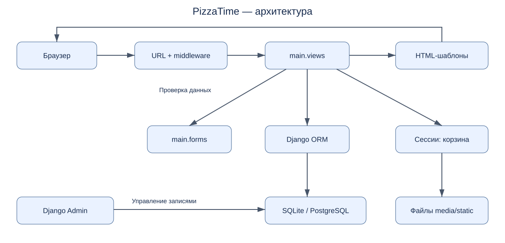

# Лабораторная 1. PizzaTime — описание проекта и требования

## Что открыть

1. Этот README — описание проекта и архитектура (пункт 1 задания).
2. [REQUIREMENTS.md](REQUIREMENTS.md) — бизнес-, пользовательские, функциональные и нефункциональные требования (пункт 2).
3. [VERIFICATION.md](VERIFICATION.md) — методы проверки каждого требования и результаты (пункт 3).
4. [ISSUES.md](ISSUES.md) — обнаруженные дефекты. Такой же реестр сохранён в корневом `ISSUES.md`.
5. [STATE_MACHINE.md](STATE_MACHINE.md) — жизненный цикл отзыва и связь с тестами (пункт 4).
6. [TASK.md](TASK.md) — условия задания преподавателя.

Диаграммы сохранены как SVG: их можно открыть двойным щелчком в браузере, запуск сайта не требуется. Исходники диаграмм также лежат в `diagrams/`.

## Название, назначение и пользователи

**PizzaTime** — учебный сайт пиццерии. Он помогает посетителю выбрать товар, собрать корзину, рассчитать стоимость с промокодом и заполнить данные доставки/самовывоза. Зарегистрированный клиент публикует отзывы. Сотрудник ведёт каталог и справочные данные через Django Admin.

Целевые пользователи: посетители сайта, зарегистрированные клиенты, сотрудники пиццерии и администраторы.

Границы реализации: оформление выводит подтверждение и очищает корзину; модели Order, истории заказов и реального платежа нет. Статистика продаж и возрастов симулируется. Лабораторные описывают эту реализацию; жизненный цикл построен для существующей модели Review.

## Стек

| Слой | Технологии |
|---|---|
| Язык | Python; Dockerfile использует Python 3.12 |
| Сервер | Django; исходный requirements.txt закрепляет Django 6.0.5 |
| Интерфейс | Django Templates, HTML, CSS |
| База | SQLite локально; PostgreSQL при установленном DATABASE_URL |
| Доступ к данным | Django ORM |
| Авторизация | Django auth, сессии, CSRF middleware |
| Графики и статика | Matplotlib (Agg), WhiteNoise |
| Запуск | manage.py runserver; Gunicorn в Dockerfile |

Фактически проверенная среда лабораторных: Python 3.9.6 / Django 4.2.30. Её зависимости отдельно закреплены в `lab2/requirements-verified.txt`; исходные зависимости проекта не изменены.

## Архитектура

Серверное MVC/MTV-приложение: запрос проходит URL-маршрутизацию и middleware, view обрабатывает данные, формы проверяют ввод, ORM читает/пишет БД, шаблон формирует HTML.



## Модули и ответственность

| Путь от корня проекта | Ответственность |
|---|---|
| `manage.py` | Команды запуска, миграций и тестирования |
| `myproject/settings.py` | БД, локаль, middleware, статика, логирование |
| `myproject/urls.py`, `main/urls.py` | Связь адресов с обработчиками |
| `main/models.py` | Category, ServiceItem, PromoCode, Review, Partner, News и справочные сущности |
| `main/forms.py` | Валидация регистрации, отзыва и оформления |
| `main/views.py` | Каталог, корзина, оформление, отзывы, информационные страницы, статистика |
| `main/context_processors.py` | Сумма корзины в шапке сайта |
| `main/admin.py` | Регистрация моделей и настройки административной панели |
| `main/templates/`, `main/static/`, `static/` | Шаблоны, стили и статические ресурсы |
| `main/migrations/` | Изменения схемы и начальные данные |
| `media/` | Загруженные изображения и видео |
| `lab1/` | Документация первой лабораторной |
| `lab2/` | Тесты, тестовые настройки, HTTP-адаптер и отчёты второй лабораторной |

## Интеграции

- БД: каталог, пользователи, отзывы, контент и серверные сессии.
- Сессия: словарь корзины вида `{ID товара: количество}`.
- Файловая система: изображения в MEDIA_ROOT, статические файлы в STATIC_ROOT после collectstatic.
- Matplotlib: создание PNG-графика в памяти, передача в HTML как base64.
- Сайты партнёров: в основном приложении это ссылки; серверные HTTP-запросы не выполняются.
- Учебное дополнение `lab2/integrations/partner_status.py` читает URL из Partner и проверяет HTTP-доступность. Оно нужно для задания с HTTP-заглушками; в страницы сайта не встроено.

## Сборка и запуск

Команды выполняются из корня проекта. Для исходного стека нужен Python 3.12+:

```bash
python3.12 -m venv .venv-app
source .venv-app/bin/activate
python -m pip install -r requirements.txt
python manage.py migrate
python manage.py createsuperuser
python manage.py runserver
```

Windows: вместо `source` выполнить `.venv-app\Scripts\activate`. Адрес сайта — `http://127.0.0.1:8000/`, административной панели — `/admin/`. Создание суперпользователя нужно только для работы сотрудника.

Альтернатива для воспроизведения проверенной лабораторной среды: установить зависимости из `lab2/requirements-verified.txt` в отдельное окружение Python 3.9.6.

```bash
python -m pip install -r lab2/requirements-verified.txt
python manage.py migrate
python manage.py runserver
```

Перед production-раздачей статики: `python manage.py collectstatic --noinput`. Docker: `docker compose up --build`. В текущем Compose веб-контейнеру не передан DATABASE_URL, поэтому он продолжает использовать SQLite, хотя сервис PostgreSQL тоже запускается. Для PostgreSQL требуется задать DATABASE_URL; текущая настройка подключения требует SSL.
