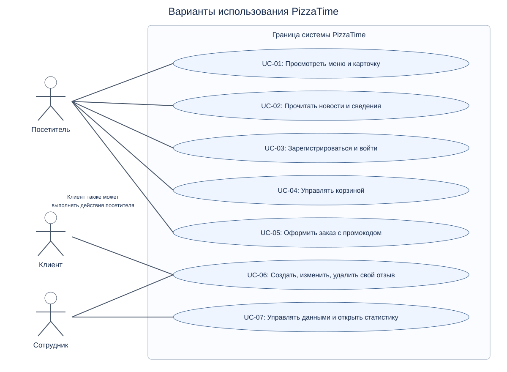

# Спецификация требований PizzaTime

Версия 2; проверка 27.10.2026. Границы: существующее Django-приложение и отдельно обозначенное учебное дополнение EXT-01. Заказ не является сохраняемой сущностью; реальная оплата не входит в реализованную систему.

## Бизнес-требования

Проблема: клиенту нужен единый доступ к ассортименту, стоимости оформления и отзывам. Цели: обеспечить выбор товара, автоматический расчёт и управляемую обратную связь. Измеримые критерии приёмки приведены в BR-01–BR-03.

## Бизнес-требования

| ID | Проверяемое требование |
|---|---|
| BR-01 | Сократить действия выбора товара: посетитель получает каталог, фильтр, сортировку и карточку в одном сайте. Приёмка: все четыре операции выполняются без авторизации. |
| BR-02 | Автоматизировать расчёт заказа: для товара 18,50 BYN с активной скидкой 10% получить 16,65 BYN и завершить оформление. |
| BR-03 | Дать клиенту управление обратной связью: публикация, изменение и удаление своего отзыва; чужой пользователь не изменяет запись. |

## Пользовательские требования

| ID | Проверяемое требование |
|---|---|
| UR-01 | Посетитель может выбрать товар через каталог и карточку. |
| UR-02 | Посетитель может читать новости, сведения о компании, контакты и условия. |
| UR-03 | Совершеннолетний посетитель может зарегистрироваться и войти. |
| UR-04 | Посетитель может добавить, увеличить, уменьшить и удалить позицию корзины. |
| UR-05 | Посетитель может оформить доставку/самовывоз и применить активный промокод. |
| UR-06 | Авторизованный клиент может публиковать, редактировать и удалять свой отзыв. |
| UR-07 | Администратор с правами может вести справочные данные и смотреть статистику при любом допустимом каталоге. |

## Функциональные требования

| ID | Проверяемое требование |
|---|---|
| FR-01 | Каталог возвращает только товары выбранной категории. |
| FR-02 | Каталог сортирует товары по цене в обе стороны и по названию. |
| FR-03 | Карточка существующего товара возвращает 200, отсутствующего — 404. |
| FR-04 | POST добавления увеличивает количество товара; GET его не добавляет. |
| FR-05 | Корзина вычисляет сумму как цену из БД, умноженную на количество в сессии. |
| FR-06 | Изменение количества и удаление позиции сохраняются в сессии. |
| FR-07 | Пустая корзина не допускается к оформлению. |
| FR-08 | Форма оформления требует имя, телефон, корректный email, известные способы получения/оплаты и согласие; имя ограничено 100 символами. |
| FR-09 | Доставка требует адрес, самовывоз допускает пустой адрес. |
| FR-10 | Активный промокод распознаётся без учёта регистра и пробелов по краям; скидка рассчитывается в процентах. |
| FR-11 | Неизвестный/неактивный промокод возвращает ошибку и сохраняет корзину. |
| FR-12 | Успешное оформление показывает подтверждение и очищает корзину. |
| FR-13 | Регистрация проверяет телефон по формату +375(XX)XXXXXXX и возраст не менее 18 лет. |
| FR-14 | Регистрация создаёт уникальное имя пользователя и автоматически авторизует его. |
| FR-15 | Вход принимает верный пароль и отклоняет неверный; выход завершает сессию авторизации. |
| FR-16 | Отзыв принимает целочисленный рейтинг от 1 до 5 и текст от 5 символов. |
| FR-17 | Опубликованный отзыв связан с текущим пользователем и отображает его имя. |
| FR-18 | Изменять/удалять отзыв может автор или staff; другой клиент получает отказ без изменения записи. |
| FR-19 | Невалидная публикация/правка не создаёт запись и не меняет прежние значения соответственно. |
| FR-20 | Удаление отзыва требует POST; GET не изменяет БД. |
| FR-21 | Список новостей ограничен семью последними, в порядке от новых к старым; отсутствующая новость — 404. |
| FR-22 | Информационные страницы отображают записи из соответствующих моделей. |
| FR-23 | Статистика недоступна гостю/обычному клиенту и доступна staff для каталога с категориями и без них. |
| FR-24 | Анонимная публикация отзыва получает контролируемый отказ: redirect, 401 или 403. |
| FR-25 | Некорректный идентификатор категории обрабатывается без 500: фильтр игнорируется либо возвращается 400/404. |
| FR-26 | Администратор с полномочиями может создать категорию через Django Admin. |

## Нефункциональные требования

| ID | Проверяемое требование |
|---|---|
| NFR-01 | Пароль не хранится открытым текстом; его хеш проверяется стандартным check_password. |
| NFR-02 | Изменяющий POST без CSRF-токена отклоняется кодом 403 при включённой CSRF-проверке. |
| NFR-03 | Корзины двух независимых клиентов изолированы. |
| NFR-04 | Невалидный внешний ввод (категория abc, анонимная публикация) не вызывает HTTP 500. |
| NFR-05 | Покрытие исполняемых строк прикладного Python-кода составляет не менее 70%, без миграций, конфигурации и сгенерированного кода. |
| NFR-06 | Русский текст из БД сохраняется и присутствует в HTML-ответе без потери символов. |

## Учебное дополнение для HTTP-интеграции

| ID | Проверяемое требование |
|---|---|
| EXT-01 | Учебный HTTP-адаптер читает URL партнёра, отправляет GET с timeout=3 и возвращает True только для HTTP 200; ошибки транспорта дают False, не-HTTP схема — ValueError. |

## Use case диаграмма и сценарии

[Исходник PlantUML](diagrams/use-cases.puml). Овалы — варианты использования, человечки — акторы, линии — доступные им действия. Клиент наследует возможности посетителя.

| Use case / требование | Актор и предусловие | Основной сценарий | Результат / исключение |
|---|---|---|---|
| UC-01 / UR-01 | Посетитель; каталог заполнен | Открыть меню → выбрать категорию/сортировку → карточку | Данные товара; отсутствующий ID → 404 |
| UC-02 / UR-02 | Посетитель | Открыть новости, контакты или сведения | Страница с данными; отсутствующая новость → 404 |
| UC-03 / UR-03 | Посетитель 18+ | Ввести телефон, дату, пароль → зарегистрироваться → выйти → войти | Пользователь и сессия; неверные поля → ошибки |
| UC-04 / UR-04 | Посетитель; товар существует | Добавить → увеличить → уменьшить → удалить | Корзина отражает каждое действие |
| UC-05 / UR-05 | Посетитель; корзина заполнена | Заполнить получение/оплату → промокод → согласие → отправить | Подтверждение и пустая корзина; ошибка → корзина сохранена |
| UC-06 / UR-06 | Клиент вошёл | Создать отзыв → изменить → удалить | Жизненный цикл Review; нет прав/неверные поля → отказ |
| UC-07 / UR-07 | Сотрудник с нужными правами | Открыть Admin → создать категорию; открыть статистику | Изменение данных; статистика с категорией сейчас нарушена (D-02) |

Метод проверки и результат **для каждого ID** находятся в [VERIFICATION.md](VERIFICATION.md).
