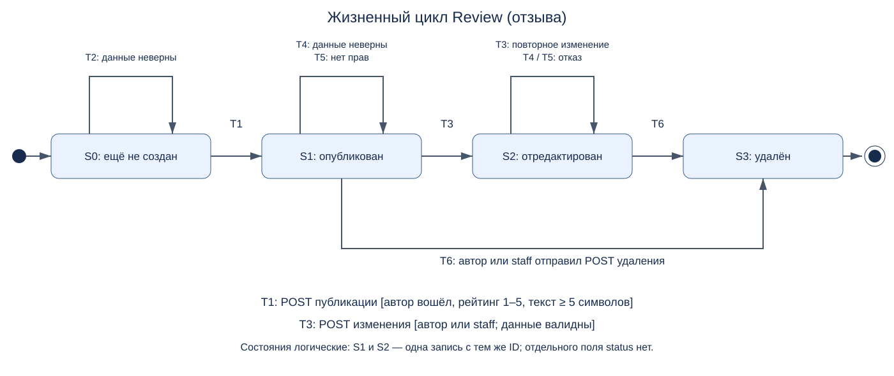

# Жизненный цикл сущности Review

Выбрана реальная сущность **отзыв** (`main.models.Review`). Начальное состояние S0 — отзыв ещё не создан; конечное S3 — удалён. В БД нет отдельного поля status: состояния определяются наличием записи и фактом её изменения. S2 обозначает опубликованный отзыв после успешного редактирования, а не отдельный статус модели.

[Исходник Mermaid](diagrams/review-lifecycle.mmd).

| Переход | Из → в | Событие и условие | Наблюдаемый результат | Сценарный тест в test_lifecycle.py |
|---|---|---|---|---|
| T1 | S0 → S1 | POST `/reviews/`; пользователь вошёл; рейтинг 1–5, текст ≥5 символов | Запись с автором создана и видна в списке | `test_review_created_edited_deleted_by_owner` |
| T2 | S0 → S0 | POST публикации с некорректными данными | Ошибки формы; записи нет | `test_invalid_create_and_edit_do_not_change_state` |
| T3 | S1 → S2 | POST `/reviews/edit/<id>/`; автор или staff; данные валидны | Тот же ID; новые текст и рейтинг | `test_review_created_edited_deleted_by_owner` |
| T3 | S2 → S2 | Повторный валидный POST редактирования | Данные обновлены повторно | `test_edited_review_repeated_updates_and_rejections` |
| T4 | S1/S2 → то же | Невалидный POST редактирования | Прежние значения в БД | `test_invalid_create_and_edit_do_not_change_state`, `test_edited_review_repeated_updates_and_rejections` |
| T5 | S1/S2 → то же | Чужой пользователь пытается изменить/удалить отзыв | Запись и значения сохранены | `test_stranger_cannot_change_published_review`, `test_edited_review_repeated_updates_and_rejections` |
| T6 | S1 → S3 | POST удаления автором или staff | Запись отсутствует | `test_published_review_deleted_without_editing` |
| T6 | S2 → S3 | POST удаления автором или staff | Запись отсутствует, повторное открытие — 404 | `test_review_created_edited_deleted_by_owner`, `test_staff_can_edit_and_delete_another_users_review` |

Два расхождения с корректным контрактом зарегистрированы отдельно: анонимная публикация даёт 500 (D-01), GET может удалить отзыв (D-04). Диаграмма показывает допустимые переходы; найденные нарушения не объявляются нормой.
